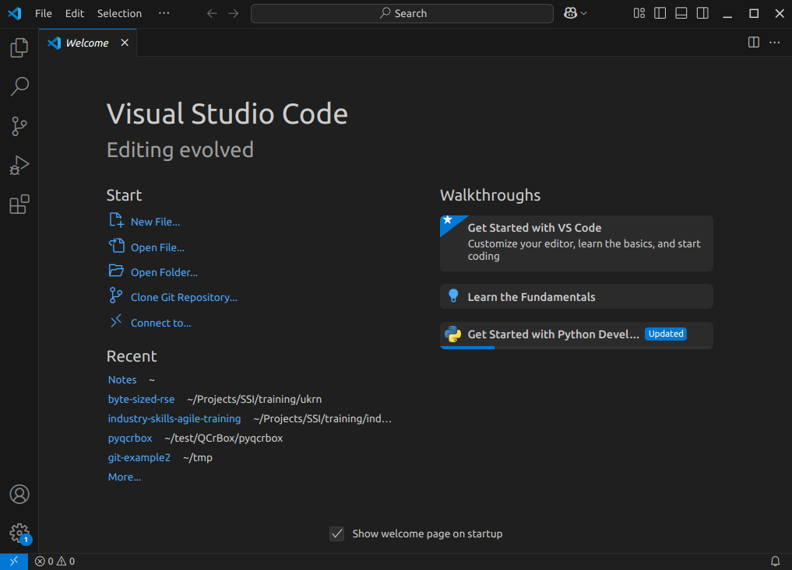

:::::::::::::::::::::::::::::::::::::: questions 

- How do I access the key features of Microsoft Visual Studio (VS) Code?
- How do I open a software project in VSCode?
- What are VSCode extensions, and how do I use them?
- What editing features will help me when writing code?
- How do I run code in VSCode?

::::::::::::::::::::::::::::::::::::::::::::::::

::::::::::::::::::::::::::::::::::::: objectives

- Describe the general layout of the VSCode interface
- Check out an existing remote GitHub repository
- Open a code folder in VSCode using the explorer feature
- Install and configure an extension to VSCode that helps with Python code development
- Use syntax highlighting to identify code styling issues and common coding mistakes
- Use code completion to automate finishing an incomplete code statement
- Use VSCode to run a Python script and have any text output displayed within a terminal

::::::::::::::::::::::::::::::::::::::::::::::::

This session provides an introduction to Integrated Development Environments (IDEs), powerful tools for software development. We will explore how various features built into IDEs can streamline your software development workflow, 
especially through their built-in debugging tools — which allow you to identify and fix issues with your code efficiently. 

## Introduction to IDEs

### What is an Integrated Development Environment (IDE)?

An Integrated Development Environment (IDE) is a graphical application that provides a comprehensive workspace for writing, editing, testing, and debugging code—all in one place. 
At the core of an IDE is a code editor, and it combines several tools that developers need into a single interface to streamline the code development process. 
IDEs are extremely useful and modern software development would be very hard without them. 

Historically, developers typically wrote code using simple text editors, often terminal-based with no graphical interface or syntax checking support. 
They had to rely on separate tools outside the editor to compile, debug, and manage their code, making development a much more fragmented experience. 
It is worth noting that popular terminal-based editors such as Emacs and Vim may appear deceptively simple at first glance - but they are, in fact, highly 
powerful and customisable frameworks for coding and automating development workflows.

Today, although some IDEs are designed for specific programming languages, many modern IDEs can support multiple languages through a wide variety of plugins — often created and maintained by the developer community.

### Why use an IDE?

An IDE brings everything you need to write, test, and debug code into one place — saving time by helping you write better code faster.
IDEs help by:

- reducing setup and development time - everything you need for editing, running, and debugging code is in one place and the need to switch between different tools/applications/windows is significantly reduced
- offering helpful tools like syntax checking, code suggestions and autocomplete, and error checking leading to fewer errors thanks to real-time feedback and intelligent suggestions
- making it easier to debug and test code leading to easier issue detection and fixing
- providing a consistent environment across projects

For beginners, IDEs lower the barrier to entry by making it easier to spot mistakes and understand code structure. 
For experienced developers, IDEs boost productivity and streamline complex workflows.

### Common IDE Features

Let’s look at what most IDEs offer - these features all work together to make your life easier when coding:

- Code editor with syntax highlighting and automatic code formatting for better readability and consistency
- Intelligent code completion that suggests syntactically correct options as you type to speed up development
- Powerful search tools to quickly locate functions, classes, or variables
- Inline documentation and reference lookup to understand symbols (functions, parameters, classes, fields, and methods) and variables definitions and usage without leaving your code
- Built-in support for running and managing tests through integrated testing frameworks
- Seamless integration with version control systems (like Git) for tracking changes and collaboration
- Debugging tools for setting breakpoints, stepping through code, and inspecting variables during runtime
- An integrated terminal for executing commands directly within the IDE
- A project/file explorer for easy navigation and management of your software project
- Viewing various files in different file formats (CSV, JSON, YAML, images, HTML, etc.) that are part of your software project 

Some IDEs also offer: 

- Deployment tools to package and release your code efficiently
- Basic project and issue tracking features to support task management

### Popular IDEs
  
Here are a few widely used IDEs across different languages and fields:

- [Visual Studio Code (VS Code)](https://code.visualstudio.com/) – lightweight and highly customisable; supports many languages
- [PyCharm](https://www.jetbrains.com/pycharm/) – great for Python development
- [RStudio](https://posit.co/download/rstudio-desktop/) – tailored for R programming but allows users to mix (R Markdown) text with code in R, Python, Julia, shell scripts, SQL, Stan, JavaScript, C, C++, Fortran, and others, similar to Jupyter Notebooks.
- [Eclipse](https://eclipseide.org/) – often used for Java and other compiled languages
- [JupyterLab](https://jupyter.org/) – interactive environment for Python and data science
- [Spyder](https://www.spyder-ide.org/) – popular among scientists using Python


## An Example Project

For this lesson we'll be using some example data held in a repository on GitHub,
which we'll check out onto our machines using VSCode.
The repository is available at `https://github.com/Southampton-RSG-Training/ai-tools-example.git`.


## Getting Started with VSCode

Let's start by running VSCode now on our machines.
How you run VSCode will differ depending on which operating system you have installed.

The first thing you'll likely see is a welcome-style page with links to features for opening files, and creating or opening a project.
You may find it asks you which kind of theme you'd like - you can select from either a dark or light theme.

### Checking out our Example Code in VSCode

To download a copy of the example project, we can use VSCode's built-in Git support:

1. On the VSCode welcome page, select `Clone Git Repository`.
   Alternatively, select the `Source Control` icon on the left represented by three small circles connected by lines.
1. Enter `https://github.com/Southampton-RSG-Training/ai-tools-example.git`
   as the repository URL into the text box at the top of VSCode, and then select `Clone from URL`.
1. Use the file browser to choose a convenient location to store the project,
   and select `Select as Repository Destination`.
1. When VSCode asks whether you would like to open the cloned repository,
   select `Open`.

::::::::::::::::::::::::::::::::: callout

## Cloning a Repository from the Command Line

If you encounter problems using the VSCode IDE interface,
you can clone a repo using the command line instead.

1. Select `Terminal` from the VSCode menu, and then select `New Terminal`.
   On Windows, use Command Prompt or Git Bash; on Linux or Mac, use the default terminal.
1. If necessary, use `cd` to navigate to the folder where you want to store the project.
1. Enter the following command:

   ```bash
   git clone https://github.com/Southampton-RSG-Training/ai-tools-example.git
   ```

1. Once cloning has finished, select `File` and then `Open Folder...`.
   Use the file browser to open the `ai-tools-example` folder created in the terminal's current directory.

:::::::::::::::::::::::::::::::::::::::::

You may be presented with a window asking whether you trust the authors of the code.
In general, it's a good idea to be at least a little wary, since you're obtaining code from the internet,
so be sure to check your sources!
Be careful here - I found on Windows the "Trust" option appears on the left,
whilst on Mac, it appears on the right!
In this case, feel free to trust the repository.
You'll then see the explorer present you with some files in a small window (or pane) on the left that you can use to navigate.

::::::::::::::::::::::::::::::::: callout

## Opening a Project that is already on your Computer

If you already have a project on your computer, VSCode can open its folder directly.
Select the `Explorer` icon from the left navigation bar, then select `Open Folder`.
Alternatively, select `File` from the top menu bar, and select `Open Folder...`.
Use the file browser to locate the project directory and select `Open`.
Note that we are looking for the *folder* that contains the project files,
not a specific file.

:::::::::::::::::::::::::::::::::::::::::

::::::::::::::::::::::::::::::::::::::::: instructor

## Checkpoint: who has been able to check out the code and open it within VSCode?

:::::::::::::::::::::::::::::::::::::::::


### Navigating Around VSCode

So let's take a look at the application.
You'll see some icons on the left side, which give you access to its key features.
Hovering your mouse over each one will show a tooltip that names that feature:

{alt='Screenshot of VSCode interface' .image-with-shadow width="100%" }

- `Explorer` - the top one is a file navigator, or explorer - we can use this to open existing folders containing program files.
- `Search ` - the next one down is a search capability, so you can search for things (and replace them with other text) over your code files.
- `Source control` - this gives you access to source code control, which includes Git version control functionality. This feature means you can do things like clone Git repositories (for example, from GitHub), add and commit files to a repository, things like that.

  ::::::::::::::::::::::::::::::::: callout
    
  If you're not familiar with Git, that's totally fine - you don't have to use this feature, although it's worth looking into using version control for writing your code.
  Version control Systems like Git allow you to manage your code by storing it - and all the changes you make to it - within a repository hosted elsewhere, for example, on GitHub.

  :::::::::::::::::::::::::::::::::::::::::

- `Run and Debug` - this allows you to run programs you write in a special way with a debugger, which allows you to check the state of your program as it is running, which is very useful and we'll look into later.
- `Extensions` - which we'll look into right now, allows you to install extensions to VSCode to extend its functionality in some way.

At the very bottom of the main VSCode window is the `Status bar`, which will show us the status of a number of things,
such as the Python interpreter we're currently using, the current Git branch we're on, and also the status of key extensions,
such as Copilot that we'll look into shortly.

There are many other features and ways to access them, and we'll cover key ones throughout this lesson.

### Installing Extensions

Extensions are a major strength of VSCode. Whilst VSCode appears quite lightweight, and presents a simple interface (particularly compared to many other IDEs!), this is quite deceptive.
You can extend its functionality in many different ways. 
For example, installing support for other languages, greater support for version control, there's even support for working with databases, and so on.
There are literally tens of thousands of possible extensions now.

Now VSCode already comes with built-in support for JavaScript, including TypeScript and node.js,
but also has extensions for other languages too (C++, C#, Java, PHP, Go, and many others).
Installing a language extension will allow you to do more things with that particular language in VSCode, as we'll see now.

Let's install an extension now:

1. Firstly, select the extensions icon, then type in "Python" into the search box at the top, and it'll give you a list of all Python-related extensions.
1. Select the one which says `Python` from Microsoft. This is the Microsoft official Python extension.
1. Then select `Install`.

It might take a minute - you can see a sliding blue line in the top left to indicate it's working.

::::::::::::::::::::::::::::::::::::::::: instructor

## Checkpoint: who's successfully managed to install the Python extension?

::::::::::::::::::::::::::::::::::::::::: 

Once complete, you should see a couple of "Welcome" windows introducing you to two of its key features - support for Python and Jupyter notebooks.
If you use Jupyter notebooks, which is a way of writing Python programs that you can run line by line from within an editor as you write the program, you may find this useful.


## Testing our Machine's Bash and Python

Before we do anything else, let's test our Bash shell and Python installation
by running a terminal from within VSCode.

Within VSCode, select `Terminal` from its menu at the top and then `New Terminal`.

You should see a Bash prompt that has a `$` somewhere in the prompt,
e.g. on Windows Git Bash (although yours will differ):

```bash
User@MyMachine MINGW64 ~/ai-tools-example (main)
$ 
```

::::::::::::::::::::::::::::::::::::::::: instructor

## Checkpoint: who sees a Bash `$` prompt?

::::::::::::::::::::::::::::::::::::::::: 

::::::::::::::::::::::::::::::::: callout

## On macOS, I see a `%` in the Prompt Instead

This means you're running Z Shell (`zsh`) instead of Bash,
and you'll need to change the default terminal type to Bash.

1. Select `Code` from the VSCode menu, then `Preferences` and then `Settings`.
1. Type `terminal.integrated.defaultProfile.osx` in the search bar.
1. In the setting that appears, select `bash` from the dropdown.
1. Open a new terminal by selecting `Terminal` from the VSCode menu, then `New Terminal`.

If you are presented with a Bash terminal that looks something like the following, you're ready:

```bash
machine-name:~ username $ 
```

Alternatively, a quick way to run Bash is to select the dropdown icon, a downwards arrow next to `+`,
and select `bash` to run a Bash terminal instead,
although you'll need to remember this each time you open a terminal.

:::::::::::::::::::::::::::::::::::::::::

::::::::::::::::::::::::::::::::: callout

## On Windows, I only see a `PS>` PowerShell prompt?

If you open a terminal on Windows but see a PowerShell prompt instead (which looks like `PS>`),
you'll need to change the default terminal type to Git Bash.

1. Select `File` from the VSCode menu, then `Preferences` and then `Settings`.
1. Type `terminal.integrated.defaultProfile.windows` in the search bar.
1. In the setting that appears, select `Git Bash` from the dropdown.
1. Open a new terminal by selecting `Terminal` from the VSCode menu, then `New Terminal`.

If you are presented with a Git Bash terminal that looks something like the following, you're ready:

```bash
user@hostname MINGW64 ~
$ 
```

Alternatively, a quick way to run Git Bash is to select the dropdown icon, a downwards arrow next to `+`,
and select `Git Bash` to run a Git Bash terminal,
although you'll need to remember this each time you open a terminal.

If you can't get this to work, you can use the Windows Terminal instead.
See the `Windows Git Bash: use the Windows Terminal (Command Prompt) Instead` callout below for instructions,
then continue the lesson from here.

:::::::::::::::::::::::::::::::::::::::::

Next, run the following which should return the version of Python on our machine:

```bash
python --version
```

::::::::::::::::::::::::::::::::: callout

## Windows Git Bash: Being Redirected to the Microsoft Store?

Windows includes fake `python.exe` shortcuts that redirect to the Microsoft Store
which block Git Bash from finding your real installation.

1. Open the Windows Start menu and search for `Manage app execution aliases`.
2. Toggle Off both `App Installer (python.exe)` and `App Installer (python3.exe)`.
3. Restart Git Bash and try running `python --version` again.

If you can't get this to work, you can use the Windows Terminal instead.
See the `Windows Git Bash: Python Command Not Found?` callout below.

If you can't get this to work, you can use the Windows Terminal instead.
See the `Windows Git Bash: use the Windows Terminal (Command Prompt) Instead` callout below for instructions.

:::::::::::::::::::::::::::::::::::::::::

::::::::::::::::::::::::::::::::: callout

## Windows Git Bash: Python Command Not Found?

If you encounter an error about Python not being found, for example:

```output
-bash: python: command not found
```

Windows doesn't know where Python is located.

There are some helpful instructions on the [Real Python](https://realpython.com/add-python-to-path/) site,
for Windows, Linux and macOS.

If you can't get this to work, you can use the Windows Terminal instead.
See the `Windows Git Bash: use the Windows Terminal (Command Prompt) Instead` callout below for instructions.

:::::::::::::::::::::::::::::::::::::::::

::::::::::::::::::::::::::::::::: callout

## Windows Git Bash: Freezing after running Python?

The `python --version` command is recognized, but typing `python` by itself to open the interactive shell might cause Git Bash to freeze.
As users on [Stack Overflow](https://stackoverflow.com/questions/32597209/python-not-working-in-the-command-line-of-git-bash) point out,
you can prevent this hang by wrapping the command with `winpty`.
Run this in Git Bash to set it up permanently:

```bash
echo "alias python='winpty python.exe'" >> ~/.bashrc
source ~/.bashrc
```

This adds an `alias` to the Bash start-up script (which runs whenever a Git Bash session is started),
that ensures that `winpty` will always run Python when `python` is entered,
removing the freezing problem.

If you can't get this to work, you can use the Windows Terminal instead.
See the `Windows Git Bash: use the Windows Terminal (Command Prompt) Instead` callout below for instructions.

:::::::::::::::::::::::::::::::::::::::::

::::::::::::::::::::::::::::::::: callout

## Windows Git Bash: use the Windows Terminal (Command Prompt) Instead

A quicker alternative is to use the Windows Terminal,
also known as the Command Prompt,
which is the native Windows command line utility.

Select the dropdown icon (a pointing down arrow) beside the terminal `+` icon and select `Command Prompt` to use this type of command line instead.
Although it has a different syntax for its in-built commands,
for the purposes of this training it should be sufficient.
However you may need to swap Bash commands for their [Windows Terminal equivalents](https://linuxbasecamp.com/command-translator
(the Linux commands are on the right, and Windows equivalents are on the left).

:::::::::::::::::::::::::::::::::::::::::


## Installing Dependencies into a Virtual Environment

This particular code makes use of two very popular Python packages:

- `numpy`
- `matplotlib`

These need to be installed if we're to run the code,
and we're going to create what's known as a virtual environment to hold these packages.

:::::::::::::::::::::::::::::::::::::::::::::::: instructor

## Installing Python Packages

Who has installed a Python package before, using the program `pip`?
Who has created and used a Python virtual environment before?

:::::::::::::::::::::::::::::::::::::::::::::::::::::::::::

### Benefits of Virtual Environments

Virtual environments are an indispensible tool for managing package dependencies across multiple projects,
and could be a whole topic itself.
In the case of Python, the idea is that instead of installing Python packages at the level of our machine's Python installation,
which we could do,
we're going to install them within their own "container",
which is separate to the machine's Python installation.
Then we'll run our Python code only using packages within that virtual environment.

There are a number of key benefits to using virtual environments:

- It creates a clear separation between the packages we use for this project,
and the packages we use other projects.
- We don't end up with a machine's Python installation containing a clutter of a thousand different packages,
where determining which packages are used for which project often becomes very time consuming and prone to error.
- Since we are sure what our code actually needs as dependencies,
it becomes much easier for someone else (which could be a future version of ourselves) to know what these dependencies are and install them to use our code.
- Virtual environments are not limited to Python; for example there are similar tools for available for Ruby, Java and JavaScript.

### Setting up a Virtual Environment

Let's now create a Python virtual environment and make use of it.

```bash
python3 -m venv venv
```

Here, we're using the built-on Python `venv` module - short for virtual environment - to create a virtual environment directory called "venv".
We could have called the directory anything, but naming it `venv` (or `.venv`) is a common convention,
as is creating it within the repository root directory.
This makes sure the virtual environment is closely associated with this project, and not easily confused with another.

Once created, we can *activate* it so it's the one in use:

```bash
[Linux] source venv/bin/activate
[Mac] source venv/bin/activate
[Windows] source venv/Scripts/activate
```

You should notice the prompt changes to reflect that the virtual environment is active, which is a handy reminder. For example:

```output
(venv) $
```

:::::::::::::::::::::::::::::::::::::::::::::::: instructor

### Checkpoint: Setting up a Virtual Environment

Who has successfully created and activated their virtual environment?

:::::::::::::::::::::::::::::::::::::::::::::::::::::::::::

Now it's created, let's take a look at what's in this virtual environment at this point.

```bash
python -m pip list
```

```output
Package    Version
---------- -------
pip        22.0.2
setuptools 59.6.0
```

We can see this is essentially empty,
aside from some default packages that installed when it is created.
Depending on your version of Python, you may only see `pip` installed here.
Importantly, note that whilst within this virtual environment,
we no longer have access to any globally installed Python packages.

### Adding Packages to a Virtual Environment

Now we have our virtual environment, we can install NumPy and Matplotlib to it:

```bash
python -m pip install numpy matplotlib
```

If we do `python -m pip list` now, we can see these packages, and their dependencies, installed within the virtual environment we have activated.

If we want to deactivate this environment, and return to the global Python package context,
we can use `deactivate`.
To reactivate it again, it's the same as before:

```bash
[Linux] source venv/bin/activate
[Mac] source venv/bin/activate
[Windows] source venv/Scripts/activate
```


## Setting up Python extensions

We also need to configure the Python extension within this workspace to use the Python contained with the virtual environment we created earlier.
VSCode has a sophisticated method to access it's inner functionality known as the Command Palette, which we'll use to address this.

1. Select `View` and `Command Palette` from the VSCode menu
1. Begin typing `Python: Select Interpreter`, and then select it when it appears
1. A list of available Python installations should appear. Look for and select the one that says `./venv/bin/python` (our virtual environment). You may find it at the bottom of the list.

Once selected, the default Python interpreter for VSCode will be configured,
as depicted in the bottom right of the status bar.

For future reference, you can also change the interpreter by selecting this label.

::::::::::::::::::::::::::::::::::::::::: instructor

## Checkpoint: who's configured the Python extension?

::::::::::::::::::::::::::::::::::::::::: 

So far within VSCode we have checked out some code from a repository and opened a folder.
Whenever we open a folder in VSCode, this is referred to as a "Workspace" - essentially, a collection of a project's files and directories.
So within this workspace, you'll see the following:

- `data/` - a directory containing some example CSV files, each representing inflammation data from a series of hypothetical clinical trials for 60 patients over 40 days
- `.gitignore` - a text file that contains things that shouldn't be tracked by Git version control
- `inflammation-plot.py` - which plots three graphs of the mean, maximum, and minimum values for each day of a trial for all patients

You'll also see `venv/` which is not part of the repository, but the virtual environment we created and configured earlier.


## Using VSCode

Now we've acquainted ourselves with running VSCode, let's take a look at our example code.
Select the `inflammation-plot.py` file in the explorer window, which will bring up the contents of the file in the code editor.

```python
import glob

import numpy as np
from matplotlib import pyplot as plt

filenames = glob.glob('data/inflammation-*.csv')
filenames.sort()

for filename in filenames:
    print(filename)

    data = np.loadtxt(fname=filename, delimiter=',')

    fig = plt.figure(figsize=(10.0, 3.0))

    axes1 = fig.add_subplot(1, 3, 1)
    axes2 = fig.add_subplot(1, 3, 2)
    axes3 = fig.add_subplot(1, 3, 3)

    axes1.set_ylabel('average')
    axes1.plot(data.mean(axis=0))

    axes2.set_ylabel('max')
    axes2.plot(data.max(axis=0))

    axes3.set_ylabel('min')
    axes3.plot(data.min(axis=0))

    fig.tight_layout()
    fig.savefig(filename + '.png')
```

We'll be using this code example throughout the session.
Note that as an example, the code is deliberately written to have flaws.
Things like the line spacing is inconsistent, there are no code comments, there's some code duplication, and you may spot other issues too.
It's also deliberately been kept relatively simple.
This is for two reasons:

- Most importantly, from a training perspective, when we use Copilot later to suggest changes, we'll be able to quickly reason about the changes and how they impact the codebase
- To give us enough scope to improve it

But in essence, the code is designed to do the following:

- Loop through a list of all inflammation data files (sorted by their filename) in the `data/` subdirectory
- For each file, load the data into a Numpy array
- For that array, create a plot containing three graphs, one for each of the mean, minimum and maximum of the data
- Save the plot image to a file (essentially the same path and filename, with a `.png` added to it)

Let's take a look at some of what the code editor gives us.

::::::::::::::::::::::::::::::::: callout

## The File Explorer has Disappeared!

You may find, perhaps on reopening VSCode, that the explorer is no longer visible.
In this case, you can select `Explorer` from the sidebar to bring it back up again,
and if you don't currently have a workspace loaded,
you can select `Open Folder` to select the code folder.

:::::::::::::::::::::::::::::::::::::::::

### Syntax Highlighting

You'll notice that the Python syntax is being highlighted for us, which helps readability.

Here, it uses colour to distinguish the various parts of our program.
Functions are yellow, Python statements are purple, variables are light blue, and strings are this reddy-orange, and so on.
Which, perhaps unsurprisingly, is a feature known as Syntax Highlighting, and it's possible to edit the colour scheme to your liking for a particular language if you like, although we won't go into that now.

This is really handy to give you immediate feedback on what you are typing, and can help you to identify common syntax mistakes.
For example, deleting the closing parenthesis on `open` - the opening one goes red, with a squiggly line underneath, indicating an issue.

So this is great, and helps us understand what we are writing, and highlights some mistakes.

### Code Completion

Something that's also useful is VSCode's ability (via the Python and Pylance extensions) to help you write and format your code whilst you're typing.

For example, on a blank line somewhere, enter `for x in something:`, and press the enter (or return) key.

On the next line, we can see that it's automatically indented it for us, knowing that we're inside a loop.

Another really helpful feature is something known as code completion, or code autocomplete (in VSCode, this is referred to as IntelliSense).
This is a great time saver, and a really useful feature of IDEs.
Essentially, as you type, it works out the context of what you are doing, and gives you hints.

For example, if we start typing a variable we've already defined, for example `filenames`,
we can see that it's zeroing in as we type on the options for what we might be trying to type.
When we see `filenames`, we can press `Tab` to complete it for us.
If we then type `.`, to perhaps make use of a property or method, we'll see a list of possible options to autocomplete.

As another example, if we wanted to open another file, we might type `new_file = open(`.
In this case, it provides information on the file `open` function and its arguments, along with a description of what it does.
This is really handy to we don't have to take the time to look up all this information up on the web, for example.

::::::::::::::::::::::::::::::::: callout

### Using a Git Code Repository?

For those of you familiar with version control and who retrieved the example code via cloning its repository instead of downloading it, there are some other editor features that help with using version control.
One of these is that the filename changes colours in the file explorer depending on its status within version control:

- White - an existing file is unchanged from the copy in the local repository.
- Orange - the content of an existing file has changed, and the change(s) have not been tracked by version control yet.
- Green - a new file has been added and is unknown to version control.

So at a glance, you can get an idea of what's changed since your last commit.

:::::::::::::::::::::::::::::::::::::::::

### Summary

So in summary, many of these editing features are typical of IDEs in general,
and the great thing is that they are really helpful at saving us time.
Things like syntax highlighting, code completion, automatic code formatting and inserting docstrings, may not seem like much, but it all adds up!


## Running Python in VSCode

Now let's try running a Python script.
First, make sure your Python code doesn't have any errors!
Next, you may recall we needed NumPy and Matplotlib to run this code;
if you look at the the bottom right of VSCode's status bar, it should mention the version of Python being used, e.g. `3.14.2 (venv)`.
So here, we can see that VSCode has picked up our virtual environment we configured earlier and will use that by default.

Then, select the "Play"-looking icon at the top right of the code editor.

You should see the program run in a terminal window that appears at the bottom,
along with the following output from the program:

```output
data/inflammation-01.csv
data/inflammation-02.csv
data/inflammation-03.csv
data/inflammation-04.csv
data/inflammation-05.csv
data/inflammation-06.csv
data/inflammation-07.csv
data/inflammation-08.csv
data/inflammation-09.csv
data/inflammation-10.csv
data/inflammation-11.csv
data/inflammation-12.csv
```

After it's completed, we should see corresponding plot image files in the data directory,
essentially each with a `.png` on the end.
For example, `inflammation-01.csv.png` looks like:


::::::::::::::::::::::::::::::::::::::::: instructor

## Checkpoint: who's run their Python progran and seen this image when opening `data/inflammation-01.csv.png`?

::::::::::::::::::::::::::::::::::::::::: 

::::::::::::::::::::::::::::::::: callout

## Error: `the term conda is not recognised`

If you're running an Anaconda distribution of Python on Windows,
if you see this error it means that VSCode is not looking in the right place for Anaconda's installation.
In this case, you may need to configure VSCode accordingly:

1. Activate the Command Palette, either by selecting `View` and `Command Palette` in the menu, or by pressing `Ctrl` + `Shift` + `P` (Linux), `Mac/Windows Key` + `Shift` + `P` (Mac/Windows) simultaneously
1. Type `Terminal: Select Default Profile`
1. From the options, select the entry that's something like `Command Prompt C:\WINDOWS\...`

Hopefully that should resolve the issue.

::::::::::::::::::::::::::::::::::::::::: instructor

## Checkpoint: if you're using Conda and encountered this error, did it fix it?

::::::::::::::::::::::::::::::::::::::::: 

:::::::::::::::::::::::::::::::::::::::::

The pop-up window is known as the "Console" or "Terminal",
and essentially is a terminal, or command prompt, where the program is run.
You'll notice that the directory where the console runs is the current VSCode project's workspace location,
and that we can also type in commands here too.
For example in Windows, you could type `dir`, on Mac or Linux you could type `ls` - to get a listing of files, for example.

We can also close this terminal/console at any time by selecting the `x` icon on the right,
and start a new one by selecting `Terminal` from the menu and selecting `New Terminal`.
So when we write and run our code, we have the option of never having to leave VSCode at all for most things.


::::::::::::::::::::::::::::::::::::: keypoints 

- Integrated Development Environments (IDEs) are all-in-one tools for writing, editing, testing, and debugging code, improving developer efficiency by reducing the need to switch between different applications
- Virtual environments are used to contain dependencies specific to a particular code project
- Key VSCode features are accessible via the left navigation bar and the menu
- VSCode's capabilities can be increased by installing extensions
- A VSCode "workspace" is a project that consists of a collection of folder and files
- Git source code repositories on GitHub can be cloned locally and opened from within VSCode
- Syntax highlighting gives you immediate feedback of potential issues as you write code
- Code completion helps to automatically finish incomplete code statements and names
- Run a script by selecting the "Play" icon in VSCode
- Output from running a Python script is displayed in the interactive "console" or "terminal"

::::::::::::::::::::::::::::::::::::::::::::::::
