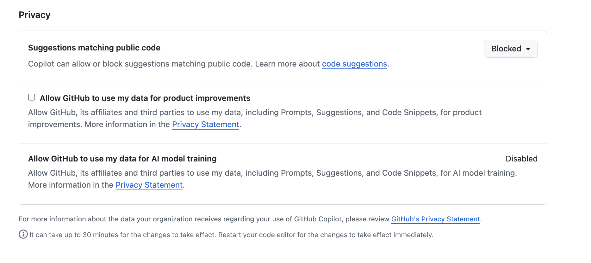
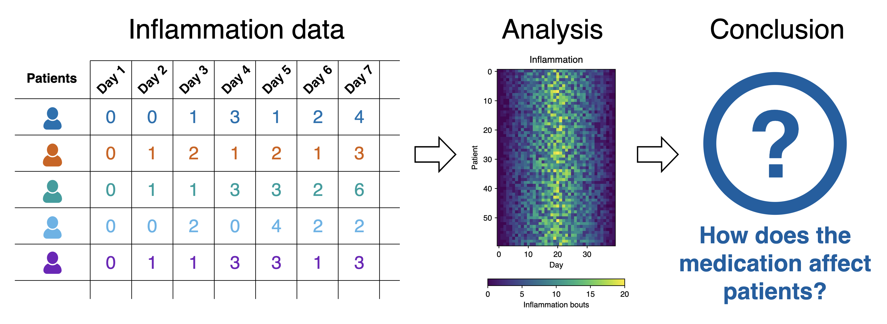
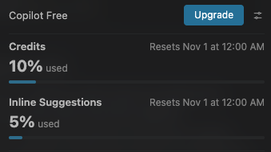

:::::::::::::::::::::::::::::::::::::: questions 

- How do I use Copilot from within Visual Studio Code?
- How can I improve the relevance of responses from Copilot for my project?
- What are the practical differences between the language models available within VSCode?
- How much of my Copilot quota have I used?

::::::::::::::::::::::::::::::::::::::::::::::::

::::::::::::::::::::::::::::::::::::: objectives

- Install and configure Visual Studio Code extension for Copilot
- Obtain answers to questions about how existing code works using Copilot's natural language chat
- Obtain suggestions on how to improve a codebase from Copilot
- Personalise Copilot suggestions to match project technologies and coding standards
- Determine Copilot usage within the free tier

::::::::::::::::::::::::::::::::::::::::::::::::

In this episode we'll look at configuring Copilot within Visual Studio Code,
so we can use it with our example project,
and explore some basic features along the way.

## Configure Copilot

Extensions are a major strength of VSCode.
Whilst VSCode appears quite lightweight, and presents a simple interface (particularly compared to many other IDEs!), this is quite deceptive.
You can extend its functionality in many different ways. 
For example, installing support for other languages, greater support for version control, there's even support for working with databases, and so on.
There are literally tens of thousands of possible extensions now.

The extension we need for GitHub Copilot is actually already installed by default for us,
so let's take a quick look at it now:

1. Firstly, select the extensions icon, then type in "Copilot" into the search box at the top, and it'll give you a list of all Copilot-related extensions.
1. Select the one which says `GitHub Copilot` from GitHub, which is the official Copilot extension. You may also see the `GitHub Copilot Chat` extension, which is deprecated and we don't need to worry about. Note the `Built-in` text next to the extension title, meaning it's already installed for use.
1. If you find it isn't installed (perhaps because you're using an older version of VSCode), select `Install`

So it's installed, but we need to associate it with our GitHub account by signing in.
Select `View` and `Chat` from the VSCode menu which should display the Copilot chat window, then:

1. Select the `Sign In` button in this window or the Copilot button in the bottom right of the VSCode status bar.
1. Select `Continue with GitHub`.
1. You'll be redirected to a GitHub login web page to authorise Visual Studio Code for GitHub. Select the GitHub account you wish to use if it exists in this list and select `Continue`, otherwise add your account here.
1. Peruse and select `Authorize Visual-Studio-Code`.
1. Depending on how you have youre GitHub account configured, you may need to perform further authentication with GitHub authorise this action, for example using Multi-Factor Authentication.
1. If a pop-up appears in your browser to open a link within VSCode, select `Open Link`.

Once completed, you should now be able to use GitHub Copilot within VSCode.

::::::::::::::::::::::::::::::::::::::::: instructor

## Checkpoint: I've logged the Copilot extension into my GitHub account

::::::::::::::::::::::::::::::::::::::::: 

::::::::::::::::::::::::::::::::: callout

## Decide on Copilot Privacy Settings

Within GitHub itself, since Copilot's VSCode configuration inherits from GitHub's configuration,
as a first step we can and should decide and configure a suitable level of privacy for how Copilot will operate;
particularly if we are making use of sensitive or otherwise confidential data within our codebase.

We can set this within our GitHub user settings, which will apply to all we do with Copilot:

1. Select your GitHub profile icon at github.com, and select `Copilot settings`
1. Scroll down to `Privacy`:

   

By default, in the free tier, the first two are enabled.

In general, it's a good idea to disable `Suggestions matching public code` since the risk is that it may make use of public code sources in a way that isn't properly licensed.
In addition, it's recommended to disable the other one (depending on the extent you trust GitHub and their affiliates),
since - as it clearly states - they allow GitHub and others to use your inputs and outputs (which includes code) for product improvements.

::::::::::::::::::::::::::::::::::::::::: instructor

## Checkpoint: I've configured my privacy settings

::::::::::::::::::::::::::::::::::::::::: 


:::::::::::::::::::::::::::::::::::::::::

## Asking Questions about Your Code

Attempting to understand a new codebase, whether it's your first week on a project or one you have inherited from another source, can be difficult. 
This can be due to many reasons; documentation may be incomplete, architectural decisions may be undocumented,
and the people who know the system may be unavailable or have left the organisation.

We can use Copilot to build our understanding and confidence about our codebase by asking natural-language questions about the code. It helps you:

- Build a high-level mental model of the system, which with complex codebases is often a huge task!
- Identify where key functionality is located in the code
- Understand naming conventions, patterns, and dependencies
- Reduce the cognitive load of first contact with unfamiliar code

Which sounds great, but with one critical caveat:
it's important to understand that Copilot is not an absolute source of truth,
but more of a guide to help build your own understanding of a codebase.

Let's use Copilot to help us investigate how our existing codebase works.

:::::::::::::::::::::::::::::::::::::::::  callout

## What Does the Patient Inflammation Data Contain?

Each dataset file in `data/` records inflammation measurements from a separate clinical trial of the drug,
and each dataset contains information for 60 patients,
who had their inflammation levels recorded (in some arbitrary units of inflammation measurement) for 40 days whilst participating in the trial.

These datasets are reused from the
[Software Carpentry Python novice lesson](https://swcarpentry.github.io/python-novice-inflammation/index.html).

{alt='Snapshot of the inflammation dataset' .image-with-shadow width="800px" }

Each of the data files uses the popular
[comma-separated (CSV) format](https://en.wikipedia.org/wiki/Comma-separated_values)
to represent the data, where:

- each row holds inflammation measurements for a single patient
- each column represents a successive day in the trial
- each cell represents an inflammation reading on a given day for a patient
  
::::::::::::::::::::::::::::::::::::::::::::::::::

### A Quick Tour of Copilot Chat

Let's move over to using the VSCode chat pane on the right.
You'll notice at the bottom there's a "Chat with Copilot" box,
with a number of selectable dropdown options below it.

You can hover over each one to discover what it is.
Let's look at the bottom row of options first.

`Set Session Target` gives you options that differ in how requests will run, how they access workspace tools, and the level of autonomy they have:

- `Local harness` - runs within VSCode Extension Host on local machine, closely integrates your active workspace with VSCode extensions and capabilities. Note that despite the `local` designation, the AI model still runs within the GitHub cloud environment.
- `GitHub Copilot harness` - runs in an isolated Agent Host on your machine, or within the cloud. Built for longer running, coordination heavy work potentially across projects, and supports autonomous workflows that run in the background.

The next dropdown on the bottom row allows you to set permissions for what Copilot can do and can't do, from `Default permissions` (where it asks you by default) to `Autopilot` (where it goes ahead and runs everything without asking).
Ensure `Default permissions` is set.

Just above this is another row of options.
From the left to the right:

- `+` / `Add Context` - choose files to add specific context for requests, to limit the scope of what you want the AI to look at
- `Set Agent` - an agent selection dropdown, which allows you to set the mode of operation with Copilot.
With the `Local` harness, each of these modes provides an increasing degree of autonomy for Copilot to interact with your code:

  - `Ask` - designed for learning and orienting yourself with existing code without changing it, and asking general questions.
  - `Plan` - lets you specify a high-level prompt to allow Copilot at a high level of autonomy to plan changes in steps, select files, and run tools or terminal commands, iterating on code edits until it is complete.
  - `Agent` (at the top) - proposes concrete code changes for your approval based on your instructions. It’s useful when you already understand a codebase that you want to change.

Note that for the `Copilot` harness the `Plan` option doesn't appear.

- `Models` - choose which AI model you wish to use. The free tier only provides access to `Auto`, meaning Copilot will choose which one to use for a task
- `Configure Model` - choose to optimise requests for `Performance`, `Balance`, or `Intelligence`, with each level taking longer to process (and costing more tokens)

We'll focus on using the Local harness for this training.

### Investigating the Codebase

Let's now use Copilot to help us understand this codebase.

1. Select the `Local` harness from the `Set Session Target` dropdown.
1. Select the `Ask` option in the `Set Agent` dropdown, since we don't want Copilot to make any changes.
1. Select the `inflammation-plot.py` file in the File Explorer.
You'll notice this appears as selectable "context" at the top of the chat box.
1. Select the `+` button to add it to the chat context - it should change to an `X` symbol. Essentially, this is what we're asking questions about.
1. In the chat window ask the very high level question: `What does this code do?`, and press enter.

You'll find the response looks something like the following:

```
The script finds every data/inflammation-*.csv file, sorts the filenames, and processes each one.

For each file, it loads the CSV as a NumPy array and creates a figure with three plots. Each plot shows a statistic for every column (typically a time point), calculated across all rows (typically patients):

- Average inflammation
- Maximum inflammation
- Minimum inflammation

It saves the figure next to the CSV, with .png appended to the filename, such as inflammation-01.csv.png. It prints each filename as it processes it; it does not display the plots interactively.
```

Note that if you hover over the response, it mentions the model used.
In this case, `GPT-6 Luna`.
Given this is automatically selected based on a number of factors,
you may find the model selected for your request was different.

::::::::::::::::::::::::::::::::: callout

## Why Aren't I Seeing the Same Response?

You'll likely find it's not exactly the same,
and not only because the AI model used was different.

Due to the ways in which LLMs process requests, based on an iterative probabilistic model,
responses based on the same question will show differences:
so essentially, AI models are *probablistic*, not *deterministic*.
This effect is often visibly compounded over time, as the probabilistic outcome of a response generates an increasingly different result.

:::::::::::::::::::::::::::::::::::::::::

::::::::::::::::::::::::::::::::: callout

## Writing Good Chat Prompts

AI tools work best with context, so it's good to be as specific and concise as possible.

It's also a good idea to provide simple questions,
so if you end up with a large question that is decomposable into separate steps,
ask each step separately and you'll typically get a better outcome.
This implies that it's good to use a logical, iterative process of using AI to assist,
using responses to simple questions to inform the next question, and so on.

There's a very useful cheat sheet developed by Northwestern University (US) Research Computing and Data Services,
which can be found in their [GitHub promptEngineering repository](https://github.com/nuitrcs/promptEngineering).

:::::::::::::::::::::::::::::::::::::::::

::::::::::::::::::::::::::::::::: callout

## Managing Context

To improve the specificity of a prompt, it's helpful to add as much context as you can.
As we've seen, we can do this if we select a file in the File Explorer and select `+` in the chat window.

Another way add context to a chat prompt you can type `#` followed by the context item you want to add,
such as a file, folder, tools, code elements (such as variables, functions or classes), tools, amongst others.
Then press `Tab` to confirm.
For example, we could type `#attachment:inflammation-plot.py` to ensure only responses relevant to that specific file will be generated.
Helpfully, it autocompletes this if you start typing `inflammation`.
In this way, we could add multiple files as context if we wanted.

Another thing to remember is how the context of each chat informs the flow of questions.
Copilot chat uses the history of a chat thread to get context about your request.
To ensure you only provide the context you want,
use separate threads for each new conversation area you wish to start,
and delete requests that are no longer relevant or otherwise not useful.

:::::::::::::::::::::::::::::::::::::::::

:::::::::::::::::::::::::: instructor

For the next exercise, in the shared notes document have a section for participants to add in answers.

:::::::::::::::::::::::::::::::::::::

:::::::::::::::::::::::::::::::::::::: challenge

## Improving a Chat Prompt

5 mins.

A researcher asks two questions of a particular codebase:

- "What does this do?"
- "What's wrong with this code it doesn't work"

Rewrite each of these prompts using the tips we have learned to improve the output from the model.
Add your improved questions to the shared Google Doc.

::::::::::::::::::::::::::::::::::::::::::::::::


:::::::::::::::::::::::::::::::::::::: challenge

## What do I Need to Know?

5 mins.

In the same chat thread, ask the following questions about the code:

1. Describe the main packages used
2. How is Matplotlib used to generate the plots?

Feel free to explore and ask other questions!

:::::::::::::::::::::::::: solution

1. Describe the main packages used? e.g.

```output
The script uses three packages:

- glob — Python’s standard library module. It finds files matching the pattern data/inflammation-*.csv.
- numpy (imported as np) — loads each CSV into an array and calculates the column-wise mean, maximum, and minimum.
- matplotlib.pyplot (imported as plt) — creates the three-panel plots and saves them as PNG files.
These are the packages imported in inflammation-plot.py.
```

2. How is Matplotlib used to generate the plots? e.g.

```output
For each CSV file, Matplotlib builds and saves a figure:

- plt.figure(figsize=(10.0, 3.0)) creates a figure 10 inches wide and 3 inches tall.
- fig.add_subplot(1, 3, n) creates three plots in one row. Each plot gets one statistic: the column-wise average, maximum, or minimum.
- set_ylabel(...) labels each plot’s y-axis; plot(...) draws the statistic values. The x-axis is the column position, shown by default.
- fig.tight_layout() adjusts spacing so the plots fit neatly.
- fig.savefig(filename + '.png') saves the figure as a PNG next to its CSV file.

The script saves the plots rather than opening an interactive display. These steps are in inflammation-plot.py.
```

Due to the ambiguous nature of language and how we specify prompts,
and the nature of how LLMs operate and generate responses,
as we have seen, we'll fairly typically have overlaps in responses to multiple questions.
Again, therefore, the key is to isolate what's useful,
and drill down and be increasingly specific on questioning until we have what we need
(as we would in an a typical conversation).

:::::::::::::::::::::::::::::::::::

::::::::::::::::::::::::::::::::::::::::::::::::

::::::::::::::::::::::::::::::::: callout

## Why Aren't I Seeing the Same Results for the Same Question on the Same Machine?

Sometimes, you may ask the same question and get a different response,
even on the same machine in the same editor.

As we've mentioned, LLMs are non-deterministic,
in that the same question can produce different answers.
In addition to it's probablistic nature, there are other reasons for these differences:

- Context-dependent: small changes in files, cursor position, chat history, or prompt matter
- Approximate understanding: infers intent, doesn't fully "understand" the codebase
- Model changes over time: behaviour can shift as Copilot and it's underlying models are updated

:::::::::::::::::::::::::::::::::::::::::


## Obtaining Guidance on how to Improve our Code

So far we've been asking quite specific questions about this codebase in order to learn more about it.
But let's now consider we might want to do to improve it.

Looking at the code, you may already have your own ideas for how it could be improved,
but let's ask Copilot instead.

:::::::::::::::::::::::::: instructor

Following the exercise below, talk through the possible solutions,
highlighting the key similarities and differences between each response.

:::::::::::::::::::::::::::::::::::::

:::::::::::::::::::::::::::::::::::::: challenge

## Asking Copilot to Suggest Improvements

10 mins.

- Select `+` at the top of the chat window to create a new chat conversation
- Select the `Local` harness (it defaults to `Copilot`)
- Select the `Ask` option in the `Set Agent` dropdown, since we don't want Copilot to make any changes.
- Ensure you have the `inflammation-plot.py` file open and selected in chat context
- Choose a prompt to ask Copilot how to improve this code, e.g.:
   - `How can I make this code more readable?`
   - `How should I refactor this code to be more modular?`
   - `What can I do to improve this code?`

Don't update your code with any of the suggestions just yet,
we'll come to this in the next episode.

Use any remaining time to explore asking other questions!

:::::::::::::::::::::::::: solution

For the question `How can I make this code more readable?` (your responses may differ!)

Note that it mentions the `inflammation-plot.py` file as context

```
A few simple refactors would make inflammation-plot.py much easier to follow:

- Use clearer names like csv_path instead of filename
- Split the plotting logic into a small function
- Replace repeated subplot setup with a loop
- Use pathlib instead of raw glob
- Avoid repeating the same plotting pattern three times

Example:
```

```python
from pathlib import Path

import numpy as np
import matplotlib.pyplot as plt


def plot_inflammation_summary(csv_path: Path) -> None:
    data = np.loadtxt(csv_path, delimiter=",")

    fig, axes = plt.subplots(1, 3, figsize=(10, 3))

    metrics = [
        ("average", data.mean(axis=0)),
        ("max", data.max(axis=0)),
        ("min", data.min(axis=0)),
    ]

    for ax, (label, values) in zip(axes, metrics):
        ax.set_ylabel(label)
        ax.plot(values)

    fig.tight_layout()
    fig.savefig(csv_path.with_suffix(".png"))


for csv_path in sorted(Path("data").glob("inflammation-*.csv")):
    print(csv_path)
    plot_inflammation_summary(csv_path)
```

```
Why this is more readable:

- The code now has one clear responsibility: “plot one inflammation file”
- The repeated axes1, axes2, axes3 pattern is replaced by a loop
- The metric names are stored in a single structure, so it’s obvious what is being plotted
- Path makes the file handling more Pythonic and easier to read

If you want, I can also give you a version that is even more beginner-friendly or one that matches typical scientific Python style.
```

:::::::::::::::::::::::::::::::::::

::::::::::::::::::::::::::::::::::::::::::::::::

## Personalising Copilot to Match our Project

### What is an Instructions File?

GitHub Copilot can be personalised by adding a instructions file to a repository that tells Copilot how you want it to behave in that project.

The file acts as persistent, project-level guidance for Copilot, covering things like:

- Preferred architecture and design patterns
- Coding style and naming conventions
- Approved or banned libraries
- Testing expectations and quality standards
- Security or safety rules
- How detailed Copilot’s answers should be

By giving Copilot this shared context we can specify the developer's (or developer team’s) coding conventions, reuse existing patterns, and avoid unwanted approaches, with the aim to make its suggestions more relevant for a particular project.

It serves a similar purposes to a `CONTRIBUTING.md` file in a code repository;
it provides guidance for how suggestions, code changes and contributions should be made,
but aimed at Copilot's day-to-day decisions instead.
It does this by adding context to queries from the `.github/.copilot-instructions.md` file.

For example, if we were to ask Copilot "How should I make this code more readable?",
without instructions Copilot may suggest to:

- Rename or format variable or function names inconsistently
- Change behaviour subtly in an undesired way
- Use an indentation style that isn't typically used by team members
- Without instructions, Copilot may introduce a new design pattern the repository doesn't use

### Instructions File Dos and Don'ts

Do:

- Structure using markdown headings and bullet points for readability
- Use clear and concise language, e.g. "Implement", "Use"
- Use imperative language where it makes sense, e.g. "MUST", "ALWAYS", "NEVER"
- Be specific and actionable
- Explain reasoning when it adds value
- Include examples
- Refer to best practices

Don't:

- Use ambigious or vague language (like "should", "perhaps")
- Include overly verbose explanations (these use more tokens and risk ambiguity)
- Add contradictory statements
- Copy-paste from other sources without adding project context (to keep it specific and relevant)
- Add rules for scenarios that haven't occurred


### Create an Instructions File

In general, it's a good idea to start with a minimal ruleset and build it from there.
So let's create a short instructions file now.

In VSCode terminal (or open a new one via `Terminal` -> `New Terminal`),
let's create a blank file then edit it in the editor:

```bash
mkdir .github
touch .github/copilot-instructions.md
```

Open the file in the editor by navigating to it in the File Explorer,
then add the following content:

```markdown
## General

- ALWAYS include comments on design decisions
- ALWAYS include a docstring for functions
- ALWAYS include type hints
- Write clear and concise comments when needed
- Ensure functions have descriptive names
- Break down complex functions into smaller, more manageable functions

## Code style and formatting

- Follow PEP 8 style guide
- Maintain 4 spaces for each level of indentation
- Add function and class docstrings in the reStructuredText format

## Project structure

- `data/` - contains inflammation CSV files
- `inflammation-plot.py` - the main code entrypoint
```

Then save the file (`File` -> `Save`).

This is only a minimal example.
You can find guidance on how to write good instructions files all over the web, e.g.

- [PlagueHO GitHub Copilot Assets Library](https://github.com/PlagueHO/github-copilot-assets-library/blob/main/instructions/python.instructions.md)
- [5 tips for writing better custom instructions for Copilot](https://github.blog/ai-and-ml/github-copilot/5-tips-for-writing-better-custom-instructions-for-copilot/)

For a more general resource on all things Copilot,
with lots of examples, see [Awesome GitHub Copilot](https://github.com/github/awesome-copilot) which contains a horde of useful examples for different Copilot agents, instructions, skills, and many other aspects.

::::::::::::::::::::::::::::::::::::::::: instructor

## Checkpoint: I've added a Copilot instructions file

::::::::::::::::::::::::::::::::::::::::: 

From this starting point we are free to update this file manually as we continue to develop the code.
This context should be used whenever we interact with Copilot,
although note that this is not guaranteed,
since LLMs (particularly on the free tier) have a limited contextual memory and these instructions may be pushed out of the context if the context gets too large.
But in any case, we're essentially documenting the coding standards for our project,
which is established good software development practice.


### Specifying Privacy per File Type

In VS Code, GitHub Copilot gives developers some mechanisms to control the level of privacy.
This should be considered important where our code uses sensitive or otherwise confidential data,
or potentially valuable IP-related code, such as algorithms.

At a high level, Copilot works by sending small, relevant snippets of your open code (plus surrounding context) to the Copilot service to generate suggestions.
You don’t explicitly "upload a project", but you do control which files Copilot is allowed to see and draw context from.

The most practical control is scoping Copilot by file, folder, or workspace.
In VS Code you can disable Copilot entirely, or selectively turn it off for particular file types (for example, configuration files, data files, or notebooks).

For example, we edit our VSCode settings to ignore csv files by:

1. Using `Ctrl + Shift + P` or `Cmd/Windows Key + Shift + P` to open the Command Palette
1. Entering and selecting `Preferences: Open User Settings (JSON)`
1. In the `settings.json` file that appears, add the following and save the file:

   ```yaml
      "github.copilot.enable": {
         "*": true,
         "csv": false
      }
   ```

This will have the effect of potentially including all file types in context by default,
but not CSV files, although importantly, this also means it won't benefit from examining these files.
Note we could also set this per workspace instead if wanted.

::::::::::::::::::::::::::::::::::::::::: instructor

## Checkpoint: I've disabled the inclusion of csv files

::::::::::::::::::::::::::::::::::::::::: 

If you wanted a stricter "default deny" approach instead, you could specify `false` for `*` and enable each filetype explicitly.

There are stricter controls, including some that allow exclusion by directory specifications,
but these are currently limited to Copilot Business users for their repositories and organisations.


:::::::::::::::::::::::::: instructor

For the next exercise, add two sections - one each for Benefits and Risks, so that participants can add their own comments to each category.

:::::::::::::::::::::::::::::::::::::

:::::::::::::::::::::::::::::::::::::: challenge

## Class Discussion: What are the Benefits and Risks?

5 mins.

Having used some of the features of Copilot,
what do *you* think are:

- The benefits are of using it?
- The risks of using it? What could go wrong?

:::::::::::::::::::::::::: solution

Possible benefits:

- Accelerates coding by generating boilerplate, scaffolding, and repetitive patterns
- Helps explore implementation options and alternative approaches quickly
- Assists with learning unfamiliar APIs, frameworks, and languages
- Improves consistency by mirroring local code style and conventions
- Speeds up refactoring, renaming, and small transformations
- Frees developer time to focus on higher level concerns

Possible risks:

- Discourages critical thinking
- Produce plausible but incorrect or incomplete code
- Subtly adapt code behaviour that is undesired and difficult to detect
- Suggest outdated or deprecated patterns
- Ignore project-specific requirements or architectural decisions
- Obscures rationale and decision-making responsibility
- Risks licensing or provenance uncertainty if not reviewed
- Reinforce poor existing patterns in the codebase
- Can deskill developers if used uncritically
- Risks generating incorrect output data which ends up in a research publication

:::::::::::::::::::::::::::::::::::

::::::::::::::::::::::::::::::::::::::::::::::::

::::::::::::::::::::::::::::::::: callout

## Do Not Assign Rational where it Doesn't Exist

It's tempting to assign a reason why AI models are making certain suggestions.
However, it's importnat to note that there is no high-level rationale at all, despite appearances.

Copilot and similar tools are *suggesting patterns*, not *reasoning about intent* —
and that distinction really matters when you’re building software you’ll have to maintain into the future.
Remember that such tools can be confidently incorrect.

If you assume "Copilot must have chosen this for a good reason", you miss the critical step:
your own review and justification.

One way to consider Copilot is as a fast junior developer with infinite autocomplete and zero accountability!
Such tools are optimised for help, not correctness: suggestions still need human review.

:::::::::::::::::::::::::::::::::::::::::

## What's my Copilot Usage?

It's important to keep track of just how much of our Copilot "plan" we're using,
particularly since we're (by default) on the free tier of Copilot.
We can see an overview of what we've consumed and how much is remaining by selecting the Copilot icon
(on the left of the bell-shaped icon on the far bottom right of the status bar), e.g.



So in this case, we can see that this user has consumed 10% of premium credits (which are chat-based and agent-based use of Copilot),
and 5% of its quota for inline suggestions (which we'll look at later).

This allowance resets on a monthly basis, 
the date of which is also displayed.

::::::::::::::::::::::::::::::::::::: keypoints 

- Copilot's capabilities are added to VSCode by installing two plugins, GitHub Copilot and GitHub Copilot chat.
- Consider and configure the level of privacy for Copilot by configuring it within your account at GitHub's website.
- Generally, it's recommended to disable `Suggestions matching public code` at a minimum to avoid it making use of public code sources in a way that isn't properly licensed.
- Copilot has three modes of operation: Ask, Edit and Agent, each delegating a higher degree of autonomy to Copilot.
- Due to the way LLMs process requests, responses based on the same question will likely show differences.
- To write a good chat response, be specific and add as much context as possible.
- Add context to a prompt by including `#` followed by the context, e.g. `#inflammation-plot.py` or `#codebase'`.
- Personalise Copilot's context by creating an `.github/.copilot-instructions.md` file.
- Explicitly deny (or allow) Copilot to use specific file types by editing or adding `github.copilot.enable` in `settings.json`.
- Due to the way LLMs work, there is no "rationale" behind Copilot's responses.
- Check Copilot's usage for inline suggestions and chat messages within your current tier by selecting it's icon in the status bar.

::::::::::::::::::::::::::::::::::::::::::::::::
